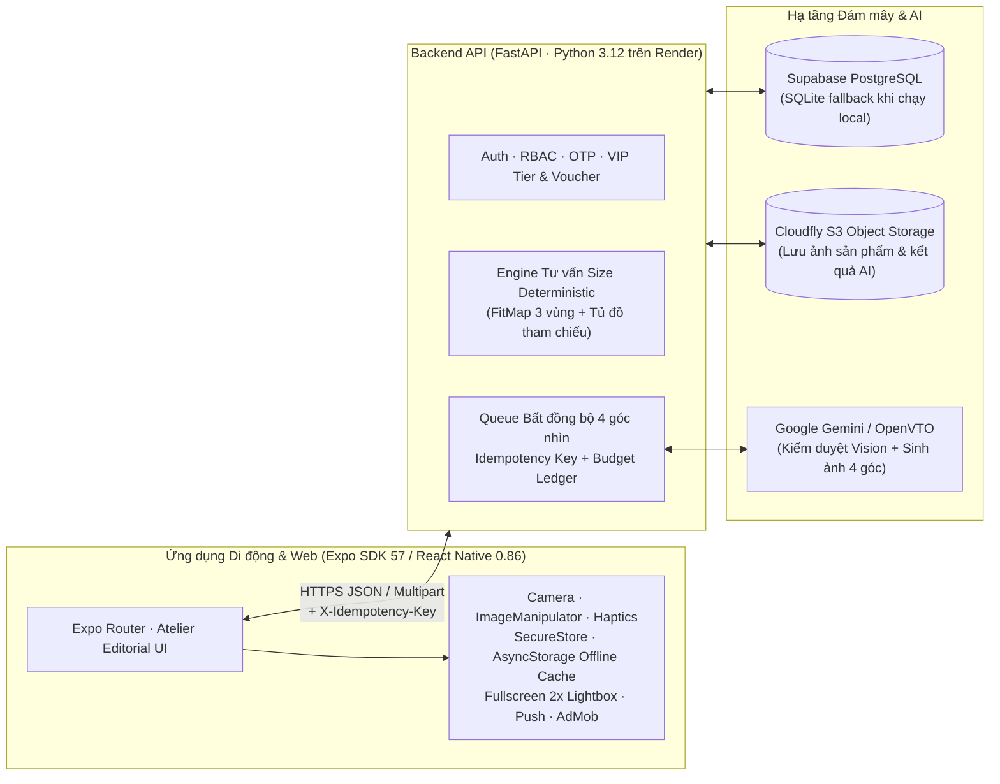

# ShopFit Studio — Ứng dụng TMĐT Thời trang tích hợp Phòng thử đồ ảo AI 4 góc & Tư vấn Size thông minh

[](https://github.com/huybitvvt/shopfit/actions/workflows/ci.yml)

**ShopFit Studio** là đồ án môn **Phát triển Ứng dụng Di động**, kết hợp luồng mua sắm thương mại điện tử thời trang hoàn chỉnh trên thiết bị di động (Android / iOS / Web) với **Phòng thử đồ ảo AI 4 góc nhìn** (Gemini / OpenVTO) và **Hệ thống tư vấn chọn size có giải thích (FitMap & Tủ đồ tham chiếu)**.

Định vị cốt lõi: **“Xem mình mặc · Hiểu vì sao vừa · Đối chiếu với thực tế”** — giúp khách mua online tự tin chọn đúng size, đồng thời cung cấp công cụ quản trị tồn kho đa biến thể và phân tích chuyển đổi AI (`Try-to-Buy`) cho chủ shop.

---

## 1. Liên kết Triển khai Thực tế (Production) & Tài khoản Bảo vệ Đồ án

| Thành phần | Địa chỉ truy cập | Ghi chú |
| --- | --- | --- |
| **Ứng dụng Web / Mobile PWA (Vercel)** | https://mobile-rose-psi.vercel.app | Tự động điều chỉnh giao diện Mobile & Desktop |
| **Backend REST API & Swagger (Render)** | https://shopfit-api.onrender.com/docs | Kết nối Supabase PostgreSQL & Cloudfly S3 |
| **Gói cài đặt Android Native (APK)** | `artifacts/ShopFit-preview.apk` | Build bằng `scripts/build-android.ps1` (SDK 57 + Hermes) |

### Tài khoản Demo phục vụ chấm thi & bảo vệ

| Vai trò | Tài khoản đăng nhập | Mật khẩu | Dữ liệu chuẩn bị sẵn |
| --- | --- | --- | --- |
| **Chủ Shop (Admin)** | `chushop` | `123` | Quản trị sản phẩm 3 góc ảnh, ma trận tồn kho màu/size, duyệt đơn 1 chạm, duyệt nạp lượt VietQR, thống kê `Try-to-Buy` |
| **Khách hàng (Customer)** | `khachhang@shopfit.vn` | `123456` | Đã có sẵn **Hồ sơ cơ thể** (`160cm · 50kg · 84-66-90`), **Tủ đồ tham chiếu** và lịch sử đơn hoàn tất để demo tư vấn size ngay |

> Khuyến khích hội đồng tự đăng ký tài khoản mới trên ứng dụng (có kiểm tra điều khoản dịch vụ, tặng ngay **3 lượt thử AI miễn phí** và hỗ trợ khôi phục mật khẩu bằng OTP 6 số).

---

## 2. Kiến trúc Hệ thống



---

## 3. Điểm nhấn Kỹ thuật & Tính năng Nổi bật

### A. Năng lực Ứng dụng Di động Bản địa (Native Mobile Capabilities)
- **Camera & Tối ưu ảnh đầu vào (`expo-image-picker` + `expo-image-manipulator`):** Chụp ảnh toàn thân trực tiếp hoặc chọn từ thư viện, tự động nén và chuẩn hóa chiều dài tối đa `1600px` ngay trên thiết bị giúp tải lên nhanh qua 4G.
- **Chế độ Ngoại tuyến & Bộ nhớ đệm (`AsyncStorage` Offline Mode):** Tự động lưu đệm danh mục sản phẩm, bảng số đo, giỏ hàng và danh sách yêu thích. Khi bật **Chế độ máy bay (Airplane Mode)**, ứng dụng vẫn mở mượt mà kèm thanh trạng thái ngoại tuyến và nút kết nối lại 1 chạm.
- **Trình xem ảnh Toàn màn hình & Phóng đại 2x (`ImageLightbox`):** Chạm vào ảnh sản phẩm (Trước / Sau / Cận chất vải) hoặc ảnh kết quả thử đồ AI 4 góc để mở chế độ toàn màn hình, kéo soi chi tiết đường may ở mức `2x` và chia sẻ nhanh (`Share` / `expo-clipboard`).
- **Phản hồi xúc giác (`expo-haptics`) & Trải nghiệm di động:** Rung phản hồi tinh tế khi chọn màu/size, lưu yêu thích, thêm giỏ hàng, lưu số đo và đặt đơn thành công; hỗ trợ `Pull-to-Refresh`, `KeyboardAvoidingView`, `SafeAreaView` và vùng chạm chuẩn `>= 48dp`.
- **Bảo mật phiên & Quyền riêng tư (`expo-secure-store`):** Lưu token phiên đăng nhập mã hóa trên Android/iOS, tự động xử lý hết hạn phiên (`401`), hỗ trợ xóa vĩnh viễn tài khoản theo chuẩn quyền riêng tư trên kho ứng dụng (ẩn danh hóa hóa đơn cũ không gây lỗi khóa ngoại).
- **Tích hợp Google AdMob chuẩn học phần (`react-native-google-mobile-ads`):** Bản APK Android tích hợp Adaptive Test Banner chính thức của Google ở cuối trang bộ sưu tập, tự động ẩn trên phiên bản Web thương mại (chi tiết tại [ADMOB.md](file:///e:/ckimobile/docs/ADMOB.md)).

### B. Phòng thử đồ ảo AI 4 góc nhìn & Tư vấn Size thông minh
1. **Kiểm tra ảnh đầu vào bằng AI Vision (`/api/photo-check`):** Xác nhận ảnh rõ nét, đứng thẳng toàn thân trước khi trừ hạn mức tạo ảnh.
2. **Sinh đồng bộ 4 góc nhìn (`Trước · Trái · Sau · Phải`):** Tận dụng ảnh mặt sau thực tế (`back_image_url`) do chủ shop tải lên để tái tạo đúng lưng áo/đầm thay vì đoán mù; kiểm tra hậu kỳ trang phục & giày giữa các góc, có cơ chế `Retry` riêng góc lỗi và nút báo cáo nội dung AI.
3. **Bản đồ độ vừa có giải thích (`Atelier Silhouette FitMap`):** Đối chiếu trực quan 3 vùng **Ngực · Eo · Mông** giữa cơ thể người mặc và thông số thành phẩm kèm độ dư chuẩn (`ease`), thước đo `Fit Gauge` 5 nấc và cảnh báo khi có vùng bị chật dù tổng điểm lệch thấp.
4. **Chọn nhanh vóc dáng 1 chạm & Tủ đồ tham chiếu (`/api/wardrobe`):** Cho phép chọn khung vóc dáng chuẩn Nam/Nữ (`S, M, L, XL`) không cần thước dây, hoặc đối chiếu trực tiếp từng cm với món đồ sẵn có ở nhà.
5. **Phản hồi Size từ Đơn đã giao (`/api/products/{id}/fit-feedback`):** Chỉ khách đã nhận hàng hoàn tất mới được gửi đánh giá `Chật / Vừa / Rộng`. Hỗ trợ tùy chọn chia sẻ nhận xét ẩn danh (`N*** A***`) giúp khách sau chọn size mà vẫn bảo vệ danh tính.

### C. Thương mại Điện tử, VIP Loyalty & Quản trị Chủ Shop
- **Giỏ hàng & Thanh toán chống tạo trùng (`X-Idempotency-Key`):** Đồng bộ giá & tồn kho theo thời gian thực, tự động tính chiết khấu hạng thành viên VIP (`Đồng · Bạc 5% · Vàng 10% · Kim Cương 15%` dựa trên đơn hoàn tất) và áp dụng mã giảm giá (`Voucher`).
- **Nạp lượt thử VietQR an toàn:** Sinh mã QR chuyển khoản tự động; tách biệt bước khách báo đã chuyển (`verifying`) với bước xác thực Webhook có chữ ký bí mật hoặc Chủ shop duyệt 1 chạm trên trang quản trị.
- **Trung tâm Quản trị Chủ shop (`/admin` & `/orders`):** Đăng/sửa toàn diện sản phẩm (3 góc ảnh, bảng 11 màu chuẩn, ma trận tồn kho từng size, bảng thông số thành phẩm thực tế), lọc nhanh mã sắp hết hàng (`<= 3`), duyệt đơn theo 5 tab trạng thái và xem thống kê **AI Retail Analytics (`Try-to-Buy Conversion Rate`)**.

---

## 4. Hướng dẫn Cài đặt & Chạy Dự án Cục bộ (Local)

### Yêu cầu môi trường
- **Node.js** `>= 20` (khuyến nghị Node 22 LTS)
- **Python** `>= 3.11` (khuyến nghị Python 3.12)
- *(Tùy chọn build APK)* **JDK 17** và **Android SDK** (`ANDROID_HOME`)

### Bước 1: Cài đặt thư viện
```powershell
npm.cmd install
npm.cmd --prefix mobile install
python -m venv backend\.venv
.\backend\.venv\Scripts\pip install -r backend\requirements.txt
```

### Bước 2: Cấu hình biến môi trường (Tùy chọn)
Sao chép `backend/.env.example` sang `backend/.env` nếu muốn gắn khóa `GEMINI_API_KEY` riêng để sinh ảnh AI thật ở máy local (mặc định hệ thống tự khởi tạo SQLite tại `backend/data/shopfit.db` cùng dữ liệu mẫu khi chạy offline).

### Bước 3: Khởi chạy Backend & Ứng dụng Mobile/Web
```powershell
# Terminal 1 — Chạy FastAPI Backend tại http://localhost:8000
node scripts/api.mjs

# Terminal 2 — Chạy Expo (nhấn w mở Web, a mở Android, hoặc quét QR bằng Expo Go)
npm.cmd --prefix mobile run start
```

---

## 5. Kiểm thử Tự động, CI/CD & Đóng gói APK

Dự án được thiết lập **GitHub Actions CI** ([ci.yml](file:///e:/ckimobile/.github/workflows/ci.yml)) tự động kiểm tra toàn bộ Backend & Mobile sau mỗi lần `git push`:

```powershell
# 1. Kiểm tra kiểu tĩnh TypeScript & ESLint chuẩn React 19 / Expo SDK 57
npm.cmd --prefix mobile run typecheck
npm.cmd --prefix mobile run lint
cd mobile; npx.cmd expo install --check

# 2. Chạy bộ 60 kiểm thử tự động Backend (Auth, Kho, VIP/Voucher, VietQR, Sizing, Try-On 4 góc, Quyền riêng tư)
cd backend; .\.venv\Scripts\python.exe -m pytest tests -q

# 3. Chuẩn bị dữ liệu mẫu thực tế trên môi trường Demo (Idempotent)
node scripts/prepare-demo.mjs

# 4. Đóng gói file cài đặt Android APK độc lập (kèm Google Test AdMob Banner)
powershell -ExecutionPolicy Bypass -File scripts/build-android.ps1
```

File cài đặt Android sau khi đóng gói nằm tại `artifacts/ShopFit-preview.apk`, có thể cài trực tiếp lên điện thoại Android thật hoặc máy ảo Android Studio (`adb install -r artifacts/ShopFit-preview.apk`).

---

## 6. Tài liệu Kỹ thuật Chi tiết

- [PRODUCT.md](file:///e:/ckimobile/docs/PRODUCT.md) — Định vị sản phẩm, quy tắc nghiệp vụ cốt lõi và kịch bản bảo vệ đồ án 5–7 phút.
- [FITTING.md](file:///e:/ckimobile/docs/FITTING.md) — Thuật toán tư vấn size deterministic, công thức độ dư (`ease`) và kiến trúc xử lý ảnh 4 góc.
- [ANDROID.md](file:///e:/ckimobile/docs/ANDROID.md) — Hướng dẫn cấu hình Android SDK, JDK 17 và quy trình đóng gói APK.
- [ADMOB.md](file:///e:/ckimobile/docs/ADMOB.md) — Thiết kế tích hợp quảng cáo thử nghiệm Google AdMob an toàn trên Android.
- [VALIDATION.md](file:///e:/ckimobile/docs/VALIDATION.md) — Báo cáo kết quả kiểm thử tự động và giới hạn kỹ thuật minh bạch.
