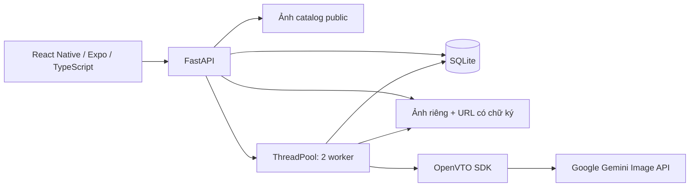

# Kiến trúc ShopFit v0.1

## Tài khoản

Mật khẩu băm PBKDF2-SHA256 với salt ngẫu nhiên. Bearer token ngẫu nhiên; chỉ hash token lưu trong database. Phiên hết hạn sau 7 ngày và bị thu hồi khi đăng xuất. Server kiểm tra vai trò cho tất cả thao tác quản trị.

## Bán hàng

`products` chứa thông tin thiết kế. `variants` khóa theo `(product_id, size, color)` và tồn kho riêng. Checkout chạy trong `BEGIN IMMEDIATE`, đọc giá hiện tại ở server rồi trừ kho có điều kiện. Bất kỳ dòng nào thất bại sẽ rollback toàn bộ. `order_items` lưu bản chụp tên/giá/ảnh tại thời điểm đặt.

Trạng thái đơn: `pending → confirmed → shipping → completed`. Có thể hủy ở `pending` hoặc `confirmed`; khách chỉ được hủy đơn của mình ở `pending`. Chuyển trạng thái và hoàn kho nằm trong cùng transaction, không hoàn kho lần hai.

`X-Idempotency-Key` ràng buộc nội dung checkout với tài khoản; request lặp trả cùng đơn và không trừ kho lần nữa. Chỉ đơn `completed` thuộc khách mới nhận đánh giá trong `fit_reviews`; mỗi order item khóa duy nhất, cập nhật không tăng số mẫu. Thống kê không chứa ảnh/số đo cá nhân.

## Thử đồ

1. Khách đăng nhập, lưu hồ sơ cơ thể, chọn sản phẩm/màu/size. Tư vấn đối chiếu số đo thành phẩm với cơ thể và độ dư do shop đặt, lọc theo biến thể còn hàng.
2. Server chuẩn hóa JPEG, xoay EXIF, giới hạn 10 MB/cạnh 1600; vision kiểm tra toàn thân/tư thế/độ rõ, cache theo chủ tài khoản + hash ảnh trong 15 phút.
3. Server lưu `queued` cùng bản chụp hồ sơ, bảng size, size được chọn và kết quả kiểm tra ảnh trước khi đưa vào worker.
4. Worker tải ảnh catalog từ thư mục sản phẩm hoặc host seed Unsplash cho phép; không fetch URL tùy ý.
5. `OpenVTOEngine` gọi pipeline upstream cho mặt trước. Sau đó lần lượt gọi provider edit của OpenVTO cho trái/sau/phải, dùng ảnh mặt trước đã thay đồ và ảnh catalog. Không gửi lại ảnh toàn thân mặc đồ cũ trong bước góc bên. Key từ `backend/.env`.
6. Ảnh bên/sau được vision kiểm tra trang phục và hướng quay. Góc đạt được lưu ngay vùng private; cuối lượt chuyển `completed` / `partial` / `failed`. Tạo lại thủ công chỉ gọi góc thiếu, tối đa hai lần trong ngày tạo; tính vào quota và không gọi lại ảnh đã có.
7. App polling mỗi 2 giây khi màn hình đang mở; lịch sử và trạng thái được đọc lại khi quay về phòng thử.

URL ảnh ký bằng HMAC với secret riêng từng lượt thử, có hạn 1 giờ; API chỉ cấp URL qua bản ghi thuộc tài khoản đăng nhập. Không đưa đường dẫn đĩa/secret vào JSON. Ai có URL ký còn hạn có thể xem ảnh, vì vậy không đưa URL vào log hoặc analytics bên ngoài.

`body_profiles` chỉ chủ tài khoản đọc/sửa/xóa. `products.size_chart` lưu số đo thành phẩm, mức dư mục tiêu, trạng thái shop xác nhận và ảnh mặt sau tùy chọn. Các bảng seed gắn nhãn chưa xác nhận. `tryons.views` lưu trạng thái/đường dẫn từng góc, chỉ serializer mới cấp URL ký. Lượt cũ một ảnh được đọc như mặt trước, các góc còn lại ghi chưa có.

`tryon_evaluations` lưu ảnh mặc thật và điểm do người dùng nhập, không tự tính độ chính xác. Ảnh này dùng cùng cơ chế ký URL và bị xóa cùng lượt thử. Migrations chỉ thêm cột/bảng, giữ dữ liệu cũ.

`wardrobe` lưu số đo quần áo khách đang mặc vừa; đối chiếu chỉ cùng loại trang phục, không suy ra số đo cơ thể. `size-advice.regions` phân loại thiếu/đạt/vượt mục tiêu và `comparison` trả chênh lệch từng kích thước; frontend dùng các con số này cho sơ đồ và lời giải thích.

Job có `request_key` và hash ảnh/lựa chọn để trả lại đúng lượt khi client gửi lại sau mất mạng. Retry có khóa riêng. Worker lưu ảnh vào file tạm rồi đổi tên, ghi `validating` và candidate path trước khi vision chạy; URL chỉ được cấp khi góc `completed`. `ai_calls` ghi dự trù trước mỗi network attempt, giữ phí dự trù cho trạng thái lỗi/unknown để không tự nới ngân sách sau restart.

## Phần cần nâng cấp trước khi vận hành thực tế

Lệnh chờ lưu SQLite nhưng dispatcher/worker vẫn là một tiến trình, chưa phải queue phân tán. Sau restart chỉ tiếp tục việc chưa bắt đầu tạo ảnh hoặc kiểm tra ảnh đã lưu; góc đang gọi tạo ảnh được đánh dấu chưa rõ kết quả để người dùng quyết định. Nâng cấp trước vận hành công khai: worker độc lập có lease, object storage, giới hạn đăng nhập, backup và HTTPS. Dự trù request theo cấu hình không bảo đảm trùng hóa đơn provider khi giá/usage thay đổi.

## Mục tiêu nghiên cứu để phát triển đồ án

- Bộ kiểm tra chất lượng khoảng 30 cặp ảnh, phân nhóm theo chất liệu, họa tiết và tư thế.
- Ghi độ trễ, tỷ lệ lỗi, mức giữ khuôn mặt và họa tiết; so sánh prompt gốc với prompt cải tiến.
- Đánh giá tư vấn size trên sản phẩm có số đo đã xác nhận và kết quả thử mặc thật.
- So sánh hai thiết kế, xuất/chia sẻ ảnh, đánh giá trải nghiệm với người dùng.

Không gắn nhãn "đo size chính xác" hoặc "giữ nguyên mọi chi tiết" khi chưa có phép đo xác nhận.
